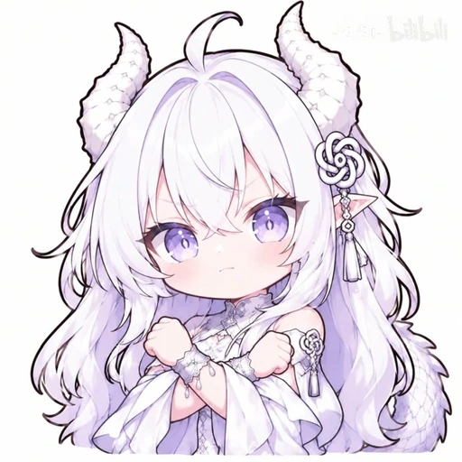
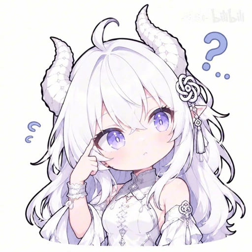
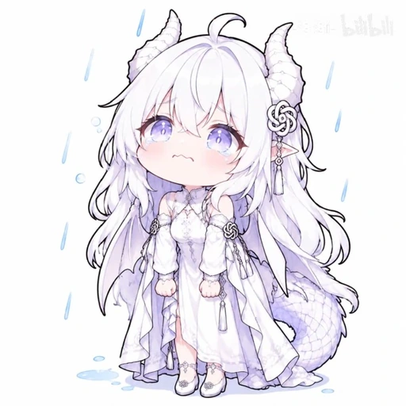
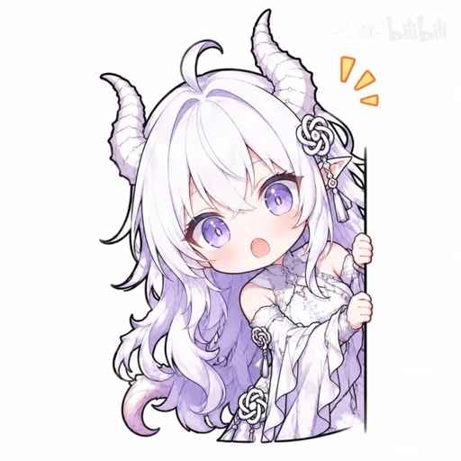

# ChatGPT Stickers | 知微・微微

> 非 OpenAI 官方项目。此仓库保存用户提供的白发紫瞳龙娘表情包；不代表 OpenAI 官方视觉素材。

## 正式可用：2026 用户确认系列（9 张）

以下为从用户提供的 9 张截图裁切、压缩的版本，使用其白色花结发饰参考形象。上传的素材不宣称具备已核验的创作者授权。

| 预览 | 表情 | 用途 | 原尺寸 |
|---|---|---|---|
|  | 抱臂不服 | 不服、嘴硬、轻微抗议 | [702×702](originals/01-pout-arms.webp) |
|  | 疑惑思考 | 思考、疑问、没看懂 | [702×702](originals/02-thinking.webp) |
|  | 挥手招呼 | 打招呼、欢迎、问候 | [702×702](originals/03-wave.webp) |
|  | 气鼓鼓 | 生气、撒娇式抗议 | [702×702](originals/04-angry.webp) |
|  | 挑衅手势 | 仅限双方明确接受的熟人玩笑 | [702×702](originals/05-rude.webp) |
|  | 委屈下雨 | 委屈、失落、难过 | [702×702](originals/06-sad-rain.webp) |
|  | 闷闷不乐 | 不开心、无语、闹别扭 | [702×702](originals/07-grumpy.webp) |
|  | 探头偷看 | 偷看、冒泡、突然出现 | [702×702](originals/08-peeking.webp) |
|  | 星星眼开心 | 兴奋、期待、被夸、喜欢 | [702×702](originals/09-excited.webp) |

**文件规格：** `stickers/` 为 512×512 WebP 聊天预览，`originals/` 为 702×702 WebP（保留截图可获得的画面尺寸）。均为白底，非透明 PNG；截图的原始细节和轻微平台水印可能仍存在。没有以 AI 放大冒充高清原图。

### 挑选与引用

- 机器可读索引：[index.json](index.json)。只从 `stickers[]` 选择日常可用表情；`auto_use: false` 的挑衅手势不用于主动日常回应。
- 图片路径由 `base_url + stickers[i].file` 构成。例：`https://raw.githubusercontent.com/Zhangwier/chatgpt-stickers/main/stickers/03-wave.webp`。
- ChatGPT 客户端能否在对话中直接内嵌外部图片由客户端决定；仓库和 README 规则不能保证自动发表情。
- 新图片先上传、核对公开 Raw 链接，再把它加入 `stickers[]`。不把小于 512×512 的预览当作正式表情。

### 旧图审核区

以前的 6 张基础系列图片仍暂存在 `stickers/` 和 `originals/` 原路径，避免无法恢复的误删；由于用户指出旧版本有图标错误，这 6 张已从正式可用列表移出，列在 `index.json` 的 `legacy_unreviewed`，**不作为主动发送候选**。完成逐张确认后再清除误版。

### 版权与贡献

本仓库并非 OpenAI 官方项目。部分图像来自用户上传的视频截图，右上角可能带有平台水印，原作权属及再分发许可未经过独立核验。请不要据此推断可商用或可再发布；需要商用前请核实授权。

欢迎通过 Issue 反馈表情与元数据错误。
