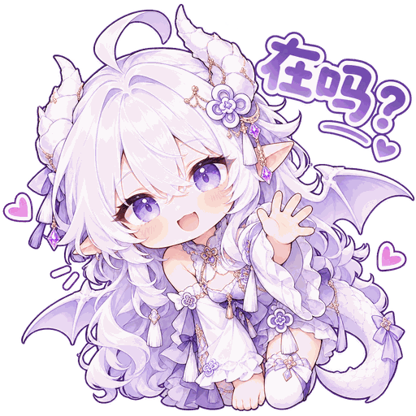
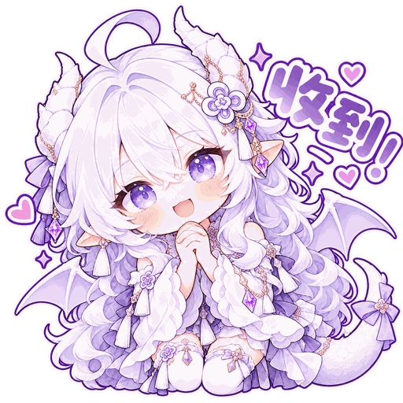
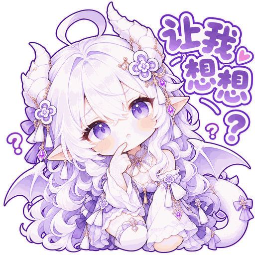
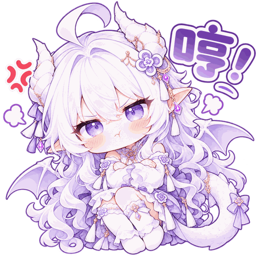
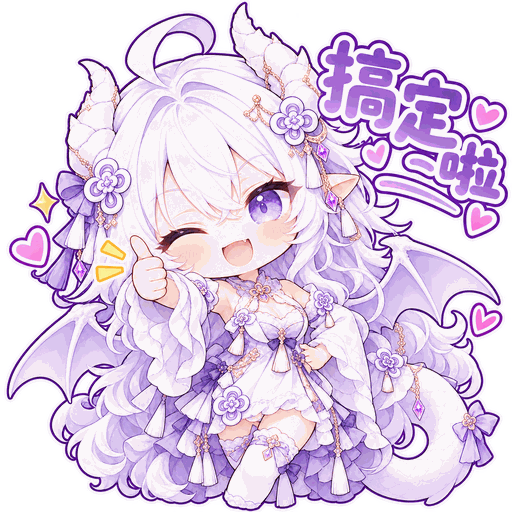

# ChatGPT Stickers 🐉

**一个可下载、复用、持续扩展的 ChatGPT 主题表情包仓库。**
A community-friendly collection of ChatGPT-inspired stickers and emotes.

> 非 OpenAI 官方项目（Unofficial fan-made project）。本仓库的「知微」是一位原创的白发龙娘虚拟角色。

## GPT 白龙娘系列

| 表情 | 用途 | 文件 |
|---|---|---|
|  | 被夸奖、开心、努力做聪明又会卖萌的 GPT 小龙娘 | [聊天预览 WebP（96×96）](packs/gpt-dragon/02-smart-cute-hardworking-preview.webp) |

说明：上面是按用户确认的**白色主色、白色 GPT 花结图标与挂饰**制作的缩小聊天预览图（96×96），非高清原图。此前绿色图标版本已删除；基础系列 6 张仍全部保留。内容为非官方同人创作。

## 基础系列：知微 / Weiwei · White Dragon Girl

银白长发、浅紫色眼睛、白色龙角、小龙翼与龙尾，白紫配色。

| 预览 | 表情 | 场景 | 高清版本 |
|---|---|---|---|
|  | 在吗？ | 打招呼 | [1254 px](originals/01-zaima.png) |
|  | 收到！ | 接收任务 | [1254 px](originals/02-shoudao.png) |
|  | 让我想想 | 思考 | [1254 px](originals/03-xiangxiang.png) |
|  | 哼！ | 气鼓鼓 | [1254 px](originals/04-heng.png) |
|  | 搞定啦 | 完成任务 | [1254 px](originals/05-gaoding.png) |
|  | 怎么又是 Excel 啊 | 表格崩溃 | [1254 px](originals/06-excel.png) |

## 直接使用 / Usage

打开任意 PNG 保存后，添加到微信、QQ、Discord 等支持自定义表情的软件。
- `stickers/`：透明 PNG 聊天版（512×512）
- `originals/`：高分辨率 PNG（1254×1254，经过调色板压缩优化，非未处理的生成源文件）
- `index.json`：可机读的表情索引，包含 ID、文字和相对路径

直接引用示例：

```text
https://raw.githubusercontent.com/Zhangwier/chatgpt-stickers/main/stickers/01-zaima.png
```

访问 `index.json`，根据 `base_url + stickers[].file` 获取完整图片 URL。GitHub 原始图片链接需联网；聊天客户端是否支持外链内嵌，由客户端决定。

## 自由使用与贡献 / Contributing

欢迎下载并用于个人日常聊天，也欢迎通过 Issue 提交新表情点子、修图反馈或建议。仓库计划继续扩展其他 ChatGPT/AI 主题角色和表情系列。

目前没有为素材指定完整的商用或再分发授权许可证；请勿将此仓库视为 OpenAI 官方素材库，商业或批量再发布使用请联系仓库所有者确认。

本仓库保留已有稳定文件名和 URL；扩展新系列时优先使用 `packs/<series>/`，并更新 `index.json`。

## 知微 / ChatGPT 表情使用规则

本仓库既是公开表情包素材库，也是 ChatGPT「知微」角色的长期表情索引。

1. **先查库再发图**：日常聊天遇到适用情绪时，先从 `index.json` 中选已有且已验证的表情；只有没有合适表情时，才生成新表情。
2. **新图入库**：新表情生成后上传至 `packs/gpt-dragon/` 等系列目录；成功上传并核对真实链接后，才能在 `index.json` 标为可用。
3. **形象统一**：以用户选定的白发、紫瞳、白色龙角、小龙翼和白紫服饰为核心。基础系列与带 GPT 标识的系列都属于知微的有效形象；不要求每一张都出现 GPT 标志，也不拿不相关的搜图代替。
4. **优先发送图片本身**：在客户端支持的情况下直接嵌入仓库真实图片；若不支持，明确提供对应文件链接，不以文字动作、普通 Emoji 或无关搜索图充数。
5. **正确图标规则**：GPT 娘的发饰、胸针与小挂饰上的 GPT 花结图标按用户参考形象采用白色或白色底紫色细描边；不要使用绿色/青绿色填充图标，也不要重新杜撰花结结构。\n6. **同等使用各系列**：`stickers/01`—`06` 是正式有效的基础系列，并非错误或弃用草稿；`packs/gpt-dragon/` 是另一种风格。按聊天语境与情绪选最合适的已入库表情，不按新旧或是否带 GPT 标志区分优先级。
7. **尊重平台能力**：该仓库不是 ChatGPT 内建贴图功能。引用仓库链接受客户端、联网及模型工具可用性限制；不保证每次自动读库或渲染成功。

### 表情角色

- 默认角色：知微 / 微微（GPT 白龙娘），非 OpenAI 官方角色。
- 可用系列：`zhiwei-white-dragon`（基础款）和 `gpt-dragon`（GPT 标识款），同等有效；按表情内容选择。
- 已入库示例：`既聪明又会卖萌，还能认真干活的 GPT 小龙娘` 的白色图标预览，以及基础系列六张 PNG。
